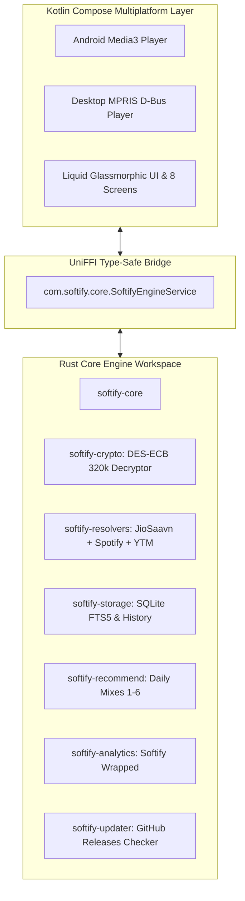

<div align="center">


# Softify Next-Gen

**Studio-Grade 320 Kbps Music Streaming · Ad-Free · Apple Music Liquid Glassmorphism**  
*Built with Pure Rust Core Engine & Kotlin Compose Multiplatform*

[](https://github.com/Sarthak-Cyb3r/Softify-Release/actions)


</div>

---

## ⚡ 1-Line Linux Command Installer

Install the Softify CLI runner and native studio audio engine with a single command:

```bash
curl -fsSL https://raw.githubusercontent.com/Sarthak-Cyb3r/Softify-Release/main/install.sh | bash
```

Once installed, stream and search studio master tracks instantly from your terminal:

```bash
softify search "Starboy"
softify lyrics "Tum Hi Ho" "Arijit Singh"
softify mixes
softify check-update
```

---

## 📱 Downloads (v0.1 Beta)

| Platform | Package Format | Direct Download |
| :--- | :--- | :--- |
| **Linux (x86_64)** | Standalone Binary + Library | [**softify-linux-x86_64.tar.gz**](https://github.com/Sarthak-Cyb3r/Softify-Release/releases/download/v0.1-beta/softify-linux-x86_64.tar.gz) |
| **Android** | Universal APK | [**Softify-v0.1-beta.apk**](https://github.com/Sarthak-Cyb3r/Softify-Release/releases/download/v0.1-beta/Softify-v0.1-beta.apk) |
| **Linux 1-Liner** | Automated Shell Script | `curl -fsSL https://raw.githubusercontent.com/Sarthak-Cyb3r/Softify-Release/main/install.sh \| bash` |

---

## 🌟 Key Highlights

### 1. Studio-Grade 320 Kbps CD Audio Fidelity
* **DES-ECB Hardware Decryptor**: Reverse-engineered JioSaavn studio engine decrypts original CDN master links (`Cipher: 38346591`).
* **Bitrate Rewrite Law**: Automatically rewrites lower bitrates (`_96.mp4` and `_160.mp4`) directly to `_320.mp4` studio master streams.
* **Pure Clean Acoustics**: Zero movie dialogues, zero applause cuts, zero compression artifacts.

### 2. Apple Music Liquid Glassmorphism UI
* **macOS Sonoma / iOS 18 Aesthetics**: Designed according to the [DESIGN.md](DESIGN.md) specification with deep obsidian canvas (`#050508`), multi-tier frosted acrylic sheets (`Surface-0` to `Surface-3`), and 1px specular bevel edge highlights.
* **Dynamic Chromatic Atmosphere**: The UI background breathes in real-time, generating an ambient Gaussian glow sampled directly from the active album cover art.
* **Spring Touch Physics**: Fluid 60/120fps touch interactions powered by Compose Multiplatform spring physics (`dampingRatio = 0.78f`, `stiffness = 380f`).

### 3. Universal Rate-Limit-Free Playlist Importer
* Paste any public **Spotify** (`open.spotify.com/playlist/...`) or **YouTube Music** link.
* Anonymous paginated token rotation fetches hundreds of songs in seconds with zero Spotify API rate limits and resolves each track to 320 Kbps studio master audio.

### 4. Romanized & Synchronized Karaoke Lyrics
* Millisecond-accurate timestamp synchronization (`[mm:ss.xx]`) with smooth auto-scroll.
* **Romanization Engine**: Automatically provides English transliterated text for non-English songs (Hindi, Punjabi, Spanish, Korean, Japanese).
* Tap any lyric line to instantly seek audio playback to that exact millisecond.

### 5. 10-Band Studio Parametric Equalizer
* 10 vertical precision glass faders covering 32 Hz to 16 kHz with interactive Bezier frequency response curves.
* Master Preamp slider (-12 dB to +12 dB) and instant studio acoustic presets (*Bass Boost*, *Acoustic*, *Vocal Polish*, *Studio Flat*, *Electronic*).

### 6. Softify Wrapped & Audio Persona
* Annual listening statistics and interactive story presentation.
* Calculates total minutes listened, top 5 artists, peak listening hours, and classifies your unique musical archetype (*The Night Cyclist*, *The Studio Purist*, *The Sonic Explorer*).

### 7. "Never Play Again" Track Muting
* Instantly blacklists selected tracks with a single tap.
* Muted songs are strictly purged across all algorithmic Daily Mixes and radio queues.

---

## 🏗 Architecture & Workspace Layout

Softify Next-Gen is built as a modular multi-crate Rust workspace linked to a Kotlin Compose Multiplatform presentation layer via Mozilla UniFFI:



### Modular Repository Structure
```
.
├── assets/                     # Official brand logos and icons
├── core/                       # Rust Core Engine Workspace
│   ├── Cargo.toml
│   ├── crates/
│   │   ├── softify-models/     # Shared canonical data models
│   │   ├── softify-crypto/     # DES-ECB decryptor & 320k rewriter
│   │   ├── softify-resolvers/  # JioSaavn, Spotify Pathfinder & YTM
│   │   ├── softify-storage/    # SQLite FTS5 catalog & playback history
│   │   ├── softify-recommend/  # Algorithmic daily mixes & mood waves
│   │   ├── softify-analytics/  # Softify Wrapped statistics engine
│   │   └── softify-updater/    # In-app GitHub release checker
│   ├── softify-core/           # UniFFI native library export
│   └── softify-cli/            # Standalone terminal runner
├── app/                        # Kotlin Compose Multiplatform Application
│   ├── src/commonMain/         # Shared Compose UI (Screens, Components, Theme)
│   ├── src/desktopMain/        # Compose for Desktop entry point
│   └── src/androidMain/        # Android Jetpack Compose entry point
├── dist/                       # Compiled Linux x86_64 binaries & Kotlin bindings
├── install.sh                  # Linux 1-line command installer
├── AGENTS.md                   # Engineering invariants & protocol specification
└── DESIGN.md                   # UI/UX design tokens & screen blueprints
```

---

## 💻 Terminal CLI Usage

```bash
# Search catalog
softify search "Blinding Lights"

# Resolve 320 Kbps stream URL
softify resolve <track-id>

# Fetch synchronized and Romanized lyrics
softify lyrics "Starboy" "The Weeknd"

# Decrypt raw JioSaavn media URL
softify decrypt "<encrypted-base64-url>"

# Download track directly to local disk as 320k AAC M4A
softify download <track-id> ./downloads

# Generate your daily algorithmic mixes
softify mixes

# Compute Softify Wrapped listening stats
softify wrapped

# Check GitHub for latest application updates
softify check-update
```

---

## 🛠 Building From Source

### Prerequisites
* **Rust**: `1.75+` (`rustup update stable`)
* **Java/JDK**: `17+` (OpenJDK)
* **Gradle**: Handled automatically via `./gradlew`

### 1. Build Rust Core & Test Workspace
```bash
cd core
cargo test --workspace
cargo build --release --workspace
```

### 2. Generate UniFFI Kotlin Bindings
```bash
cargo run --bin uniffi-bindgen generate \
  --library target/release/libsoftify_core.so \
  --language kotlin \
  --out-dir target/release/bindings/kotlin
```

### 3. Run Desktop Compose App
```bash
./gradlew :app:run
```

### 4. Build Android APK
```bash
./gradlew :app:assembleRelease
```

---

## 📄 License

Softify Next-Gen is licensed under the terms of both the **MIT License** and the **Apache License (Version 2.0)**.
